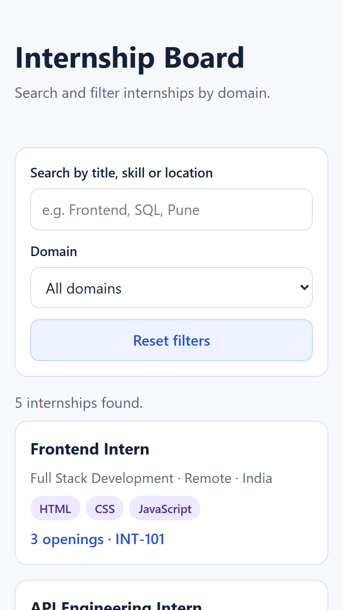
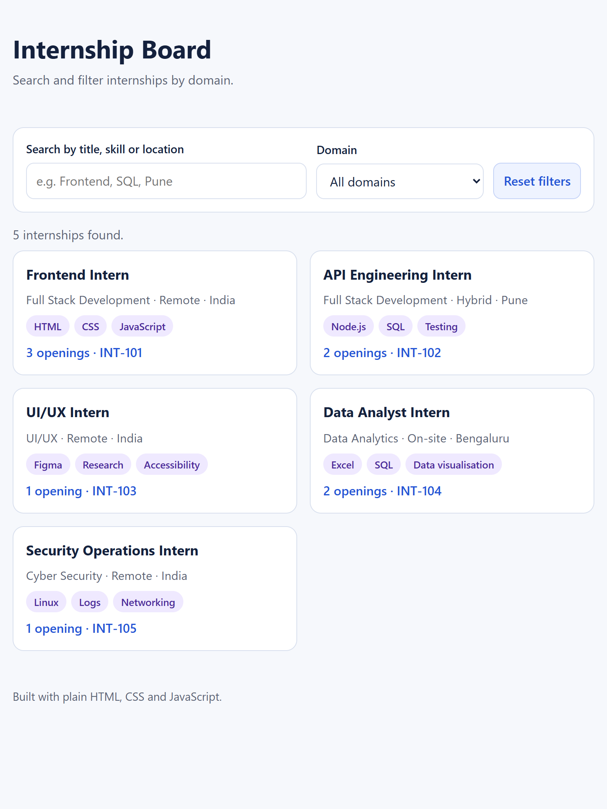
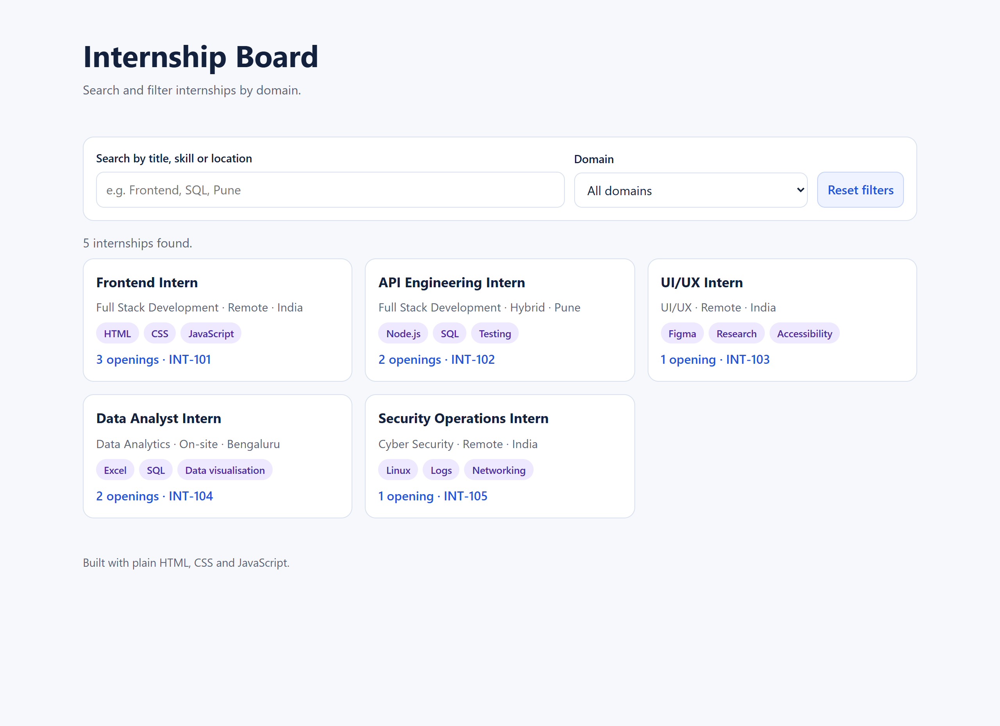

# Responsive Internship Board

An accessible, responsive internship listing interface built with plain HTML, CSS and JavaScript (no framework).

## Live preview
https://ammangour01-creator.github.io/internship-board/

## Features
- Semantic HTML (header, main, section, footer)
- Reusable card rendering from JSON data
- Search by title, skill or location
- Domain filter, combined with search
- Empty state and error state messages
- Keyboard navigation, visible focus styles, skip link
- Labelled form fields and aria-live result announcements
- Responsive layout for mobile, tablet and desktop (CSS Grid)

## Screenshots
| Mobile | Tablet | Desktop |
|---|---|---|
|  |  |  |

## Run locally
fetch() needs a server, so use the VS Code Live Server extension:
right-click index.html and choose "Open with Live Server".

## Files
- index.html - page structure
- style.css - styles and responsive layout
- script.js - data loading, filtering and rendering
- internships.json - internship records